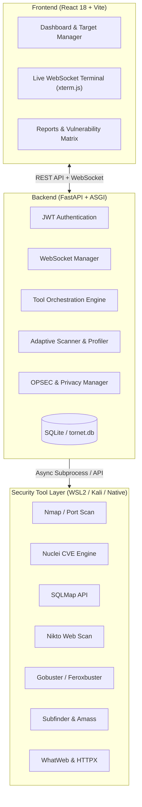

<div align="center">

# 🛡️ TORNET — Advanced Cybersecurity Command Center

**Unified, Semi-Automated Penetration Testing & Vulnerability Assessment Platform**

[](https://opensource.org/licenses/MIT)
[](https://www.python.org/)
[](https://fastapi.tiangolo.com/)
[](https://react.dev/)
[](https://www.docker.com/)
[](https://www.kali.org/)

<br/>

> **TORNET** integrates industry-standard offensive security tools into a cohesive, high-performance command center dashboard with real-time WebSocket telemetry, adaptive reconnaissance pipelines, and automated reporting.

</div>

---

> [!CAUTION]
> **DISCLAIMER & ETHICAL USE POLICY**  
> TORNET is designed **strictly for authorized penetration testing, vulnerability assessments, and educational research** conducted with explicit permission from system owners. Unauthorized access to computer systems or networks is illegal under international cyber law. The authors and contributors assume no liability for misuse.

---

## 📋 Table of Contents

- [Key Features](#-key-features)
- [Architecture](#-architecture)
- [Integrated Security Toolset](#-integrated-security-toolset)
- [Prerequisites](#-prerequisites)
- [Quick Start](#-quick-start)
  - [Native Execution (Windows / Linux)](#1-native-execution-windows--linux)
  - [Docker Compose](#2-docker-compose)
- [OPSEC & Anonymization Engine](#-opsec--anonymization-engine)
- [Plugin System](#-plugin-system)
- [Documentation](#-documentation)
- [License](#-license)

---

## ⚡ Key Features

* **🖥️ Dark Mode Command Center** — Professional SOC/Red Team dashboard with live resource telemetry, target profiling, and scan visualizers.
* **⚡ One-Click Automated Scans** — Configure target and scan profile (`Light`, `Medium`, `Aggressive`) to trigger automated multi-stage reconnaissance and vulnerability discovery.
* **🔄 Live WebSocket Terminal** — Real-time bidirectional streaming of tool outputs directly to an interactive in-browser terminal (`xterm.js`).
* **🛡️ OPSEC Shield** — Integrated anonymization engine with Tor traffic routing, automatic MAC address rotation, and VPN profile management.
* **📊 Comprehensive Reporting** — Automated risk scoring (CVSS/Severity), remediation guidance, and exportable reports in PDF, HTML, and JSON.
* **🔌 Dynamic Plugin Engine** — Add new CLI tools, custom scanners, or API fuzzers on the fly without modifying core codebase.
* **🔐 Zero-Configuration Persistence** — Local SQLite database with encrypted authentication, session management, and scheduling.

---

## 🏗️ Architecture



---

## 🔌 Integrated Security Toolset

| Category | Tools Integrated | Role |
| :--- | :--- | :--- |
| **Reconnaissance** | `Nmap`, `Subfinder`, `Amass`, `WhatWeb`, `HTTPX` | Asset discovery, open ports, service fingerprinting, technology stack |
| **Vulnerability Scanning** | `Nuclei`, `Nikto`, `OWASP ZAP` | Automated CVE verification, misconfigurations, web application flaws |
| **Exploitation & Injection** | `SQLMap`, `XSStrike`, `Metasploit RPC` | SQL injection detection, XSS proof-of-concept, exploitation verification |
| **Content Discovery** | `Gobuster`, `Feroxbuster`, `FFUF` | High-speed directory brute-forcing, sensitive endpoints, hidden assets |
| **OPSEC & Network** | `Tor`, `OpenVPN`, `Macchanger`, `Scapy` | Traffic routing, source anonymity, active packet crafting |

---

## 💻 Prerequisites

* **Operating System:** Windows 10/11 (with WSL2 enabled) or Linux (Ubuntu 22.04+ / Debian / Kali)
* **Python:** 3.11+
* **Node.js:** 18+ LTS
* **Package Managers:** `pip` and `npm`
* *(Optional)* Docker Desktop & Docker Compose

---

## 🚀 Quick Start

### 1. Native Execution (Windows / Linux)

#### Clone the repository
```bash
git clone https://github.com/robinandreoni/TorNet.git
cd TorNet
```

#### Configure Environment
```bash
cp .env.example .env
```

#### Setup Backend
```bash
cd backend
python -m venv venv

# On Windows:
venv\Scripts\activate
# On Linux / macOS:
source venv/bin/activate

pip install -r requirements.txt
```

#### Setup Frontend
```bash
cd ../frontend
npm install
```

#### ⚡ 1-Click Launchers (Windows)
From the project root:
* **Batch Launcher:** Double-click or run `start_tornet.bat`
* **PowerShell Launcher:** Run `powershell -ExecutionPolicy Bypass -File start_tornet.ps1`

Both scripts will start the backend (`http://127.0.0.1:8000`), launch the frontend (`http://127.0.0.1:5173`), and open your browser automatically.

---

### 2. Docker Compose

For a containerized setup:

```bash
cd docker
docker compose up -d
```

Access the dashboard at `http://localhost:3000` and the API documentation at `http://localhost:8000/docs`.

---

## 🛡️ OPSEC & Anonymization Engine

TORNET includes an integrated OPSEC shield designed to ensure operator privacy during security research:
* **Tor Circuit Routing:** Route command traffic through the Tor onion network.
* **Public VPN Integration:** Automated fetching and configuration of dynamic OpenVPN profiles.
* **Interface Anonymization:** Automated MAC address randomization via `macchanger`.
* **Stealth Score:** Real-time score evaluating active DNS leaks, public IP exposure, and connection security.

---

## 🔌 Plugin System

Adding a new tool is as simple as creating a JSON manifest in `backend/plugins/`:

```json
{
  "id": "custom_scanner",
  "name": "custom_scanner",
  "display_name": "My Custom Scanner",
  "category": "Vulnerability Scanning",
  "command_template": "tool-binary -u {target} {intensity_flags}",
  "enabled": true
}
```

---

## 📚 Documentation

Detailed documentation is available in the `docs/` directory:
* 📖 [Installation Guide](docs/INSTALL.md)
* 📖 [Usage & Workflows](docs/USAGE.md)
* 📖 [REST API Reference](docs/API.md)

---

## 📄 License

This project is licensed under the **MIT License** — see the [LICENSE](LICENSE) file for details.

