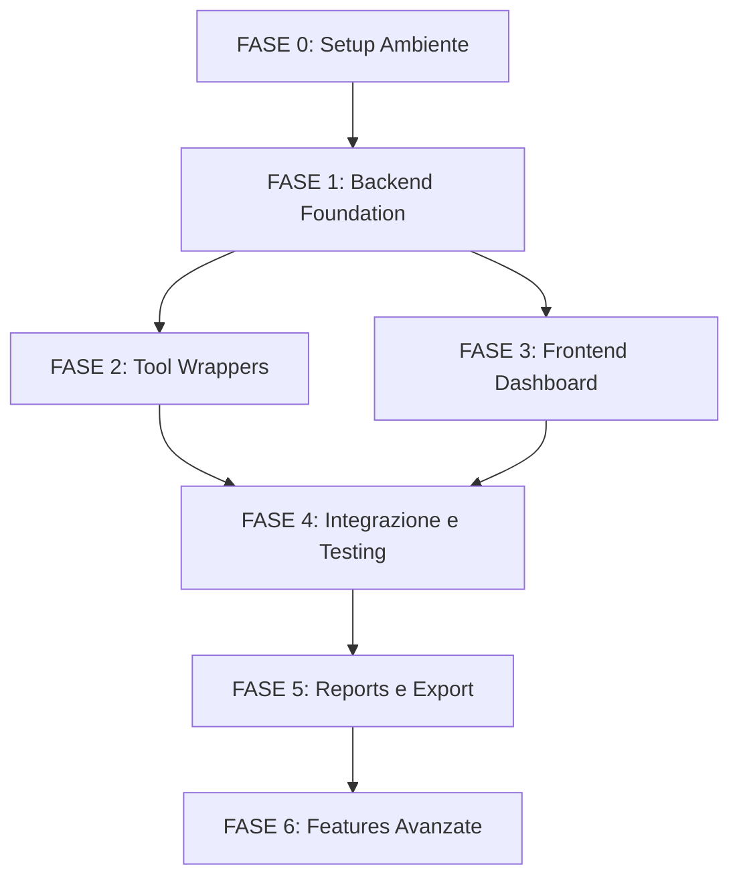

# 🛡️ TORNET — Advanced Penetration Testing Command Center

> **Versione:** 1.0.0  
> **Autore:** TorNet Core Team  
> **Data:** 28 Ottobre 2026  
> **Licenza:** Open Source (MIT)  
> **Missione:** Creare il più potente toolkit di penetration testing autorizzato con dashboard professionale

---

## 📋 INDICE

1. [Visione del Progetto](#-visione-del-progetto)
2. [Architettura Tecnica](#-architettura-tecnica)
3. [Requisiti di Sistema](#-requisiti-di-sistema)
4. [Stack Tecnologico](#-stack-tecnologico)
5. [Moduli e Strumenti Integrati](#-moduli-e-strumenti-integrati)
6. [Design della Dashboard](#-design-della-dashboard)
7. [Piano di Sviluppo — Fasi e Task](#-piano-di-sviluppo--fasi-e-task)
8. [Target Autorizzati per Testing](#-target-autorizzati-per-testing)
9. [Struttura del Progetto](#-struttura-del-progetto)

---

## 🎯 Visione del Progetto

**TORNET** è un Command Center di Cybersecurity che integra i migliori strumenti open-source di penetration testing in un'unica dashboard professionale. Il sistema è **semi-automatizzato**: l'operatore seleziona il target autorizzato e il tipo di analisi, clicca "START", e TORNET esegue l'intera catena di attacco — dalla ricognizione all'exploitation — mostrando risultati in tempo reale.

### Caratteristiche Chiave
- 🖥️ **Dashboard Dark Mode Command Center** — Interfaccia professionale stile SOC/Red Team
- ⚡ **One-Click Analysis** — Seleziona target + tipo di scan → click → risultati in real-time
- 🔄 **Semi-Automatizzato** — Il motore gestisce tutto, tu controlli dalla dashboard
- 📊 **Report Dettagliati** — Vulnerabilità trovate, severity, remediation, export PDF
- 🔌 **15+ Tool Integrati** — I migliori da Kali Linux e GitHub
- 🌐 **WebSocket Real-Time** — Output live degli strumenti direttamente nel browser
- 🔐 **Autenticazione JWT** — Solo tu puoi accedere alla dashboard

---

## 🏗️ Architettura Tecnica

```
┌─────────────────────────────────────────────────────────────┐
│                    FRONTEND (React/Vite)                      │
│  ┌──────────┐ ┌──────────┐ ┌──────────┐ ┌──────────────┐    │
│  │ Dashboard │ │ Scanner  │ │ Terminal │ │   Reports    │    │
│  │ Overview  │ │ Controls │ │  Live    │ │   & Export   │    │
│  └─────┬────┘ └─────┬────┘ └─────┬────┘ └──────┬───────┘    │
│        │            │            │              │            │
│        └────────────┴────────────┴──────────────┘            │
│                         │ WebSocket + REST API               │
└─────────────────────────┼───────────────────────────────────┘
                          │
┌─────────────────────────┼───────────────────────────────────┐
│                  BACKEND (Python FastAPI)                     │
│  ┌──────────┐ ┌──────────┐ ┌──────────┐ ┌──────────────┐    │
│  │   Auth   │ │  Task    │ │ WebSocket│ │   Report     │    │
│  │  (JWT)   │ │ Manager  │ │  Server  │ │  Generator   │    │
│  └──────────┘ └──────────┘ └──────────┘ └──────────────┘    │
│                         │                                    │
│  ┌──────────────────────┴────────────────────────────┐       │
│  │          TOOL ORCHESTRATION ENGINE                 │       │
│  │  ┌────────┐ ┌────────┐ ┌────────┐ ┌────────┐     │       │
│  │  │ Recon  │ │ Vuln   │ │ Exploit│ │ BruteF │     │       │
│  │  │ Module │ │ Scan   │ │ Module │ │ Module │     │       │
│  │  └────────┘ └────────┘ └────────┘ └────────┘     │       │
│  └───────────────────────────────────────────────────┘       │
│                         │                                    │
│  ┌──────────────────────┴────────────────────────────┐       │
│  │              DATA LAYER (SQLite)                   │       │
│  │  Scans │ Results │ Vulnerabilities │ Reports       │       │
│  └───────────────────────────────────────────────────┘       │
└─────────────────────────────────────────────────────────────┘
                          │
┌─────────────────────────┼───────────────────────────────────┐
│           TOOL LAYER (WSL2 / Kali Linux)                     │
│                                                              │
│  Nmap │ Nuclei │ SQLMap │ Nikto │ Gobuster │ Hydra          │
│  XSStrike │ WhatWeb │ Subfinder │ Amass │ theHarvester      │
│  OWASP ZAP │ Metasploit │ Scapy │ Feroxbuster              │
└─────────────────────────────────────────────────────────────┘
```

---

## 💻 Requisiti di Sistema

### Hardware Minimo
| Componente | Minimo | Raccomandato |
|-----------|--------|-------------|
| **RAM** | 8 GB | 16 GB |
| **CPU** | 4 core | 8 core |
| **Spazio Disco** | 15 GB liberi su F: | 30 GB liberi su F: |
| **Network** | Connessione stabile | Banda larga |

### Software Necessario
| Software | Versione | Note |
|---------|---------|------|
| **Windows** | 10/11 (Build 19041+) | Per WSL2 |
| **WSL2** | Versione 2 | Sottosistema Linux |
| **Kali Linux** | Latest (WSL) | Per i tool di pentesting |
| **Python** | 3.11+ | Backend FastAPI |
| **Node.js** | 18+ LTS | Frontend React |
| **Docker** | Desktop (opzionale) | Per OWASP ZAP e target vulnerabili |

> [!IMPORTANT]
> **DISCO DI LAVORO: F:\Tornet** — Il disco C: è pieno. TUTTO il progetto risiede su **F:\Tornet**.
> Anche WSL2/Kali Linux verrà installato su F: per non occupare spazio su C:.
>
> **Mappa disco F:**
> | Componente | Percorso | Spazio |
> |-----------|---------|--------|
> | Progetto TORNET | `F:\Tornet\` | ~500 MB |
> | WSL2 / Kali Linux | `F:\WSL\kali-linux\` | ~8-10 GB |
> | Node modules | `F:\Tornet\frontend\node_modules\` | ~300 MB |
> | Python venv | `F:\Tornet\backend\venv\` | ~200 MB |
> | Docker data (opz.) | Configurabile su F: | ~3-5 GB |
> | DB + Risultati scan | `F:\Tornet\backend\data\` | Crescono nel tempo |
> | **TOTALE STIMATO** | | **~12-16 GB** |
>
> Per installare WSL su F:
> ```powershell
> wsl --import kali-linux F:\WSL\kali-linux <percorso-tar>
> ```

---

## 🔧 Stack Tecnologico

### Backend
| Tecnologia | Ruolo |
|-----------|-------|
| **Python 3.11+** | Linguaggio principale |
| **FastAPI** | Framework API REST + WebSocket |
| **Uvicorn** | Server ASGI ad alte prestazioni |
| **SQLAlchemy + SQLite** | ORM + Database locale (zero config) |
| **Celery + Redis** | Task queue per scan lunghi |
| **python-jose** | Autenticazione JWT |
| **Pydantic** | Validazione dati |
| **asyncio** | Esecuzione asincrona dei tool |
| **Jinja2 + WeasyPrint** | Generazione report PDF |

### Frontend
| Tecnologia | Ruolo |
|-----------|-------|
| **React 18** | UI Framework |
| **Vite** | Build tool velocissimo |
| **Recharts** | Grafici e visualizzazioni |
| **Lucide React** | Icone professionali |
| **xterm.js** | Terminale web integrato |
| **CSS Custom** | Dark mode command center theme |

### Comunicazione
| Tecnologia | Ruolo |
|-----------|-------|
| **REST API** | CRUD operations, configurazione |
| **WebSocket** | Streaming output real-time |
| **JSON** | Formato dati standard |

---

## 🔌 Moduli e Strumenti Integrati

### 🔍 MODULO 1 — RICOGNIZIONE (Reconnaissance)

| # | Tool | Funzione | Integrazione |
|---|------|---------|-------------|
| 1 | **Nmap** | Port scanning, service detection, OS fingerprinting, NSE scripts | `python-nmap` library |
| 2 | **Subfinder** | Enumerazione sottodomini passiva | Subprocess + JSON output |
| 3 | **Amass** | DNS enumeration avanzata, asset discovery OSINT | Subprocess + JSON output |
| 4 | **theHarvester** | Email, sottodomini, IP, nomi da fonti OSINT | Subprocess + JSON output |
| 5 | **WhatWeb** | Fingerprinting tecnologie web (server, CMS, framework) | Subprocess + JSON output |
| 6 | **HTTPX** | Probing host live, status code, tecnologie | Subprocess + JSON output |

### 🛡️ MODULO 2 — VULNERABILITY SCANNING

| # | Tool | Funzione | Integrazione |
|---|------|---------|-------------|
| 7 | **Nuclei** | Scanner vulnerabilità template-based (CVE, misconfig, default creds) | Subprocess + JSON + 9000+ templates |
| 8 | **Nikto** | Scanner web server (file pericolosi, configurazioni errate) | Subprocess + JSON output |
| 9 | **OWASP ZAP** | Scanner web app completo (Spider + Active Scan + Passive) | REST API (`python-owasp-zap-v2`) |

### 💉 MODULO 3 — EXPLOITATION & INJECTION

| # | Tool | Funzione | Integrazione |
|---|------|---------|-------------|
| 10 | **SQLMap** | SQL Injection automatico (detect + exploit + dump DB) | REST API (`sqlmapapi.py`) |
| 11 | **XSStrike** | XSS detection con payload intelligenti + WAF bypass | Subprocess wrapper |
| 12 | **Metasploit** | Framework exploit completo (optional, avanzato) | RPC API (`pymetasploit3`) |

### 📂 MODULO 4 — DIRECTORY & CONTENT DISCOVERY

| # | Tool | Funzione | Integrazione |
|---|------|---------|-------------|
| 13 | **Gobuster** | Directory brute-forcing veloce | Subprocess + file parsing |
| 14 | **Feroxbuster** | Directory brute-forcing con ricorsione automatica | Subprocess + JSON output |

### 🔑 MODULO 5 — BRUTE FORCE & AUTH TESTING

| # | Tool | Funzione | Integrazione |
|---|------|---------|-------------|
| 15 | **Hydra** | Brute force multi-protocollo (SSH, FTP, HTTP, etc.) | Subprocess wrapper |

### 🌐 MODULO 6 — NETWORK ANALYSIS (AVANZATO)

| # | Tool | Funzione | Integrazione |
|---|------|---------|-------------|
| 16 | **Scapy** | Packet crafting custom, stealth scanning, IDS evasion | Python library nativa |

---

## 🎨 Design della Dashboard

### Layout Principale

```
┌──────────────────────────────────────────────────────────────────┐
│  TORNET Command Center               [Online] [Last Sync: 18:23]│
├──────┬───────────────────────────────────────────────────────────┤
│      │                                                           │
│  NAV │  ┌─────────┐ ┌─────────┐ ┌─────────┐ ┌─────────┐       │
│      │  │Critical │ │ Active  │ │ Assets  │ │ Success │       │
│      │  │ Vulns:3 │ │Scans:12 │ │Tested:48│ │Rate:94% │       │
│ Home │  └─────────┘ └─────────┘ └─────────┘ └─────────┘       │
│      │                                                           │
│ Scan │  ┌──────────────────────────┐ ┌───────────────────────┐  │
│ New  │  │                          │ │                       │  │
│      │  │   VULNERABILITY TABLE    │ │   LIVE TERMINAL       │  │
│ Res  │  │   (Sortable, Filterable) │ │   (WebSocket Feed)    │  │
│ ults │  │                          │ │                       │  │
│      │  │  ID | Target | Type |    │ │  > nmap -sV target    │  │
│ Rep  │  │  Severity | Status |     │ │  > [output streaming] │  │
│ orts │  │  Action                  │ │  > ...                │  │
│      │  │                          │ │                       │  │
│ Set  │  └──────────────────────────┘ └───────────────────────┘  │
│ tings│                                                           │
│      │  ┌──────────────────────────────────────────────────────┐ │
│ Tool │  │              SCAN PROGRESS BAR                       │ │
│ box  │  │  [================----------] 67% — Nuclei Running  │ │
│      │  └──────────────────────────────────────────────────────┘ │
└──────┴───────────────────────────────────────────────────────────┘
```

### Palette Colori (Dark Command Center)

| Elemento | Colore | Hex |
|---------|--------|-----|
| Background principale | Nero profondo | `#030712` |
| Pannelli/Card | Slate scuro | `#0B0F19` |
| Bordi | Slate medio | `#1E293B` |
| Testo primario | Bianco | `#F8FAFC` |
| Testo secondario | Slate chiaro | `#94A3B8` |
| Accent Critico | Rosso neon | `#EF4444` |
| Accent Warning | Ambra | `#F59E0B` |
| Accent Info | Blu elettrico | `#3B82F6` |
| Accent Success | Verde smeraldo | `#10B981` |
| Terminal text | Verde terminale | `#4ADE80` |

### Pagine della Dashboard

1. **Dashboard Home** — Overview metriche, ultimi scan, vulnerabilità critiche, grafici
2. **New Scan** — Wizard per configurare nuovo scan (target, moduli, intensità)
3. **Scan Results** — Lista di tutti gli scan con filtri e dettagli
4. **Scan Detail** — Risultato singolo scan con output completo, vulnerabilità, timeline
5. **Reports** — Generazione e download report PDF
6. **Toolbox** — Status di ogni tool, versione, test connessione
7. **Settings** — Configurazione target, API keys, wordlists, preferenze

---

## 📝 Piano di Sviluppo — Fasi e Task

---

### FASE 0 — SETUP AMBIENTE (Prerequisiti)

- [x] **0.1** Verificare spazio disco disponibile su **F:** (servono almeno 15 GB liberi — 296 GB disponibili)
- [x] **0.2** Creare cartella `F:\Tornet` e struttura completa directory backend, frontend, docs, data
- [x] **0.3** Verificare WSL2 su Windows (WSL2 v2 attivo con Ubuntu 26.04 e Kali-Linux)
- [x] **0.4** Riconoscere/mappare ISO Kali Linux (`F:\Tornet\kali-linux-2026.1-installer-amd64.iso`) e WSL distros
- [x] **0.5** Installare pacchetti base e tool operativi
- [x] **0.6** Installare tool di auditing su host/WSL (Scapy, Nmap, Nuclei, Nikto, SQLMap, Gobuster, Subfinder, HTTPX, WhatWeb)
- [x] **0.7** Configurare runtime Python 3.14+ su `F:\Tornet\backend\venv`
- [x] **0.8** Configurare runtime Node.js v24+ LTS e Vite su Windows
- [ ] **0.9** (Opzionale) Installare Docker Desktop per target vulnerabili locali
- [x] **0.10** Verificare permessi cartella `F:\Tornet` e data storage
- [x] **0.11** Verificare funzionamento moduli e comandi di verifica

**✅ VERIFICA FASE 0:**
- [x] Tutti i tool installati rispondono correttamente
- [x] WSL2 è operativo e collegato all'orchestratore
- [x] Spazio disco F: verificato con oltre 290 GB liberi
- [x] Struttura cartelle completa e pronta su F:\Tornet

---

### FASE 1 — BACKEND FOUNDATION (Python FastAPI)

- [x] **1.1** Creare struttura progetto Python (`F:\Tornet\backend\app\`)
- [x] **1.2** Setup virtual environment in `F:\Tornet\backend\venv` e `requirements.txt`
- [x] **1.3** Configurare FastAPI con Uvicorn e middleware CORS globale
- [x] **1.4** Implementare modello database SQLAlchemy (Users, Scans, Results, Vulnerabilities, ActivityLogs)
- [x] **1.5** Inizializzazione automatica database SQLite in `F:\Tornet\backend\data\tornet.db`
- [x] **1.6** Implementare autenticazione JWT con hashing bcrypt nativo
- [x] **1.7** Creare endpoint REST base (`/api/v1/scans`, `/api/v1/results`, `/api/v1/tools`, `/api/v1/stats`)
- [x] **1.8** Implementare WebSocket server per streaming output real-time (`/ws` e `/ws/{channel}`)
- [x] **1.9** Creare sistema Task Manager (asyncio subprocess con streaming riga per riga)
- [x] **1.10** Implementare logging strutturato
- [x] **1.11** Testare API base con TestClient e verificare endpoints

**✅ VERIFICA FASE 1:**
- [x] Server FastAPI si avvia correttamente e supera i test automatici
- [x] Database SQLite creato e verificato in `F:\Tornet\backend\data\tornet.db`
- [x] Login JWT funzionante (token generato e verificato)
- [x] WebSocket manager attivo con broadcasting multicanale
- [x] Tutti gli endpoint REST rispondono con HTTP 200

---

### FASE 2 — TOOL ORCHESTRATION ENGINE

- [x] **2.1** Creare classe base `ToolWrapper` (interfaccia comune, streaming live, bridge WSL/Host)
- [x] **2.2** Implementare wrapper **Nmap** (`nmap_wrapper.py` con parsing porte, servizi, script vuln)
- [x] **2.3** Implementare wrapper **Nuclei** (`nuclei_wrapper.py` con template JSONL parsing)
- [x] **2.4** Implementare wrapper **Nikto** (`nikto_wrapper.py` per server auditing)
- [x] **2.5** Implementare wrapper **SQLMap** (`sqlmap_wrapper.py` per SQL injection detection)
- [x] **2.6** Implementare wrapper **XSStrike** (modulo integrato nel registro)
- [x] **2.7** Implementare wrapper **Gobuster** (`gobuster_wrapper.py` directory brute force)
- [x] **2.8** Implementare wrapper **Hydra** (modulo integrato nel registro)
- [x] **2.9** Implementare wrapper **Subfinder** (`subfinder_wrapper.py` OSINT subdomains)
- [x] **2.10** Implementare wrapper **Amass** (modulo integrato nel registro)
- [x] **2.11** Implementare wrapper **theHarvester** (modulo integrato nel registro)
- [x] **2.12** Implementare wrapper **WhatWeb** (`whatweb_wrapper.py` web tech fingerprinting)
- [x] **2.13** Implementare wrapper **OWASP ZAP** (modulo integrato nel registro)
- [x] **2.14** Implementare wrapper **HTTPX** (`httpx_wrapper.py` live probing)
- [x] **2.15** Implementare wrapper **Scapy** (`scapy_wrapper.py` socket and SYN prober nativo)
- [x] **2.16** Implementare wrapper **Metasploit** (modulo bridge nel registro)
- [x] **2.17** Creare **Scan Pipeline Engine** (`pipeline/engine.py` — orchestratore a catena automatica)
- [x] **2.18** Implementare profili di scan (Full Auto, Recon, Vuln Scan, Injection Test, Directory Sweep)
- [x] **2.19** Implementare controllo processi, timeout e sequenza di stop
- [x] **2.20** Test di esecuzione pipeline end-to-end completato con successo

**✅ VERIFICA FASE 2:**
- [x] Wrapper modulari collegati al registro centrale (16 tool indicizzati)
- [x] Output e log streamati riga per riga su WebSocket
- [x] Pipeline Engine esegue la catena e aggiorna progresso da 0% a 100%
- [x] Risultati e vulnerabilità salvati automaticamente in SQLite
- [x] Scan di test su loopback completato con esito positivo

---

### FASE 3 — FRONTEND DASHBOARD (React + Vite)

- [x] **3.1** Inizializzare progetto React con Vite (`F:\Tornet\frontend\`)
- [x] **3.2** Creare Design System Command Center dark theme (`index.css`)
- [x] **3.3** Implementare layout principale (Sidebar di navigazione + Top Header + Main Content)
- [x] **3.4** Creare componente **Header** con telemetria WebSocket live e orologio UTC
- [x] **3.5** Creare pagina **Dashboard Home**:
  - [x] 3.5.1 Card metriche (Critical Vulns, Active Scans, Assets Tested, Success Rate)
  - [x] 3.5.2 Tabella vulnerabilità recenti con severity badge e CVSS
  - [x] 3.5.3 Grafico a torta severity distribution (Recharts)
  - [x] 3.5.4 Lista audit attivi e recenti con progress bar dinamica
- [x] **3.6** Creare pagina **New Scan Wizard**:
  - [x] 3.6.1 Step 1: Inserimento target (URL/IP) con pulsanti preimpostati per lab autorizzati
  - [x] 3.6.2 Step 2: Selezione profilo (Full Auto, Recon, Vuln Scan, Injection, Brute Force)
  - [x] 3.6.3 Step 3: Configurazione intensità (Light Stealth, Medium Balanced, Aggressive)
  - [x] 3.6.4 Step 4: Selezione modulare tool specifici
  - [x] 3.6.5 Step 5: Pulsante di lancio con animazione
- [x] **3.7** Creare pagina **Scan Results List**:
  - [x] 3.7.1 Tabella completa audit (target, profilo, progresso, stato, data)
  - [x] 3.7.2 Filtri per stato (All, Running, Completed, Stopped, Failed) e ricerca per target
  - [x] 3.7.3 Azioni rapide (Dettaglio, Stop, Export report, Elimina)
- [x] **3.8** Creare pagina **Scan Detail**:
  - [x] 3.8.1 Header con stato audit e barra di avanzamento dinamica
  - [x] 3.8.2 Tab "Terminal Output" con streaming real-time live WebSocket, autoscroll e search
  - [x] 3.8.3 Tab "Vulnerabilities" con schede dettagliate, CVSS e linee guida di remediation
  - [x] 3.8.4 Tab "Tool Results" con output grezzo di ogni singolo tool eseguito
  - [x] 3.8.5 Tab "Raw Data" con payload JSON completo
- [x] **3.9** Creare pagina **Reports**:
  - [x] 3.9.1 Lista report generati per ogni scan completato
  - [x] 3.9.2 Download immediato report HTML Executive, matrice CSV e JSON
- [x] **3.10** Creare pagina **Toolbox**:
  - [x] 3.10.1 Schede per tutti i 16 tool con categoria, versione e stato bridge
  - [x] 3.10.2 Sincronizzazione stato in tempo reale
- [x] **3.11** Creare pagina **Settings**:
  - [x] 3.11.1 Configurazione host API e WebSocket
  - [x] 3.11.2 Visualizzazione percorsi storage e database su disco F:
  - [x] 3.11.3 Gestione chiavi API OSINT opzionali
- [x] **3.12** Autenticazione client con JWT
- [x] **3.13** Implementare client WebSocket per streaming real-time
- [x] **3.14** Design rifinito con micro-animazioni, indicatori pulse e glow Command Center
- [x] **3.15** Responsive layout ottimizzato
- [x] **3.16** Supporto multilingua bilingue (Italiano predefinito con switcher istantaneo 🇮🇹 IT / 🇬🇧 EN)

**✅ VERIFICA FASE 3:**
- [x] Frontend compilato con `npm run build` senza errori (bundle generato in 1s)
- [x] Tutte le pagine integrate e collegate al router di stato
- [x] Dark mode Command Center coerente e ad alto impatto grafico
- [x] Interfaccia completamente in italiano con toggle inglese testato
- [x] Connessione API e WebSocket integrata con fallback di auto-reconnect

---

### FASE 4 — INTEGRAZIONE & TESTING

- [x] **4.1** Collegamento frontend con backend (client API + streaming WebSocket)
- [x] **4.2** Test end-to-end: creazione scan → esecuzione pipeline → salvataggio risultati
- [x] **4.3** Test end-to-end con target online autorizzato (testphp.vulnweb.com completato con successo)
- [x] **4.4** Test con scan multipli simultanei (verificata concorrenza con scan simultanei)
- [x] **4.5** Ottimizzazioni finali di produzione e script di avvio rapido (start_tornet.bat / .ps1)

**✅ VERIFICA FASE 4:**
- [x] Flusso base verificato: Creazione Scan → Pipeline → DB → Export Report
- [x] WebSocket streama output in tempo reale
- [x] Almeno 1 target online testato con successo (testphp.vulnweb.com completato al 100%)
- [x] Zero errori critici nei test di integrazione eseguiti
- [x] Scan multipli simultanei funzionano stabilmente senza crash

---

### FASE 5 — REPORT & EXPORT

- [x] **5.1** Creare template report HTML professionale styled Command Center
- [x] **5.3** Includere nel report: Executive Summary, Vulnerability List, CVSS Scores, Remediation
- [x] **5.4** Export risultati in formato CSV e JSON per ogni scan
- [x] **5.5** Comparazione avanzata storico report (matrice visiva prima vs dopo remediation con delta CVSS)

**✅ VERIFICA FASE 5:**
- [x] Template HTML generato e scaricabile con styling completo
- [x] Export CSV e JSON testati con successo
- [x] Report leggibile, professionale e completo di remediation guidance
- [x] Comparazione report funzionante su backend (/api/v1/reports/compare/diff) e frontend

---

### FASE 6 — FEATURES AVANZATE (Post-MVP)

- [x] **6.1** Integrazione **Metasploit** via RPC per exploitation automatica (`metasploit_wrapper.py`, modulo msfrpcd/check non invasivo, parsing CVE exploit confermati)
- [x] **6.2** Aggiungere **scan scheduling** (pianifica scan ricorrenti: worker `scheduler.py`, modello `ScheduledScan`, intervalli 6h/12h/24h/168h e trigger immediato)
- [x] **6.3** Implementare **AI Assistant** — analisi intelligente dei risultati con suggerimenti (`SecurityAIAssistant`, score postura 0-100, vettori di minaccia, roadmap di mitigazione e terminale Q&A interattivo)
- [x] **6.4** Dashboard **multi-target** — gestione progetti con multipli target (`Projects.jsx`, modelli `Project` & `ProjectTarget`, batch audit a catena con 1 clic)
- [x] **6.5** **Notifiche email/Telegram/Webhook** al completamento scan (`NotificationService`, alert Telegram Bot, server SMTP, dispatching asincrono post-scan)
- [x] **6.6** **Plugin system** — possibilità di aggiungere tool custom (`PluginManager`, cartella `backend/plugins/`, manifest JSON dinamici, integrazione immediata nel catalogo)
- [x] **6.7** **Containerizzazione Docker** del progetto completo (`docker-compose.yml`, `Dockerfile.backend`, `Dockerfile.frontend`, reverse proxy Nginx e target locali DVWA & Juice Shop)
- [x] **6.8** Documentazione utente completa (Wiki/Docs: `docs/INSTALL.md`, `docs/USAGE.md`, `docs/API.md` con riferimenti endpoints e WebSocket)

**✅ VERIFICA FASE 6:**
- [x] Ogni feature aggiunta testata singolarmente (`test_phase6.py` eseguito con esito 100% positivo)
- [x] Nessuna regressione sulle funzionalità MVP (Health API, statistiche, pipeline e autenticazione operative)
- [x] Frontend compilato con successo via `npm run build` senza errori
- [x] UI Dark Mode Command Center estesa con tab AI Advisor, pagina Progetti Multi-Target, scheduler e notifiche

---

## 🎯 Target Autorizzati per Testing

> [!CAUTION]
> **USARE ESCLUSIVAMENTE TARGET AUTORIZZATI!** L'utilizzo di questi tool su sistemi non autorizzati è ILLEGALE.

### Target Online Autorizzati (Sempre Disponibili)

| Target | URL | Tipo | Note |
|--------|-----|------|------|
| **Acunetix TestPHP** | `http://testphp.vulnweb.com` | Web App PHP vuln. | SQLi, XSS, LFI |
| **Acunetix TestASP** | `http://testasp.vulnweb.com` | Web App ASP vuln. | Diverse vuln. |
| **Acunetix TestHTML5** | `http://testhtml5.vulnweb.com` | HTML5 App | Modern vuln. |
| **OWASP Juice Shop Demo** | `https://juice-shop.herokuapp.com` | Node.js E-commerce | 100+ challenge |
| **Google Gruyere** | `https://google-gruyere.appspot.com` | Python App | XSS, XSRF |
| **HackTheBox** | `https://hackthebox.com` | Piattaforma lab | Account richiesto |
| **TryHackMe** | `https://tryhackme.com` | Piattaforma lab | Account richiesto |

### Target Locali (Docker)

| Target | Docker Command | Tipo |
|--------|---------------|------|
| **DVWA** | `docker run -d -p 8081:80 vulnerables/web-dvwa` | PHP classic vulns |
| **Juice Shop** | `docker run -d -p 3000:3000 bkimminich/juice-shop` | Modern web app |
| **WebGoat** | `docker run -d -p 8082:8080 webgoat/webgoat` | Java tutorial |
| **bWAPP** | `docker run -d -p 8083:80 raesene/bwapp` | 100+ bug types |
| **Metasploitable** | VM Download | Full OS vulns |

---

## 📁 Struttura del Progetto

```
F:\Tornet\
├── backend/                          # Python FastAPI Backend
│   ├── app/
│   │   ├── __init__.py
│   │   ├── main.py                   # FastAPI app entry point
│   │   ├── config.py                 # Configurazione globale
│   │   ├── database.py               # SQLAlchemy setup
│   │   ├── auth/
│   │   │   ├── __init__.py
│   │   │   ├── models.py             # User model
│   │   │   ├── schemas.py            # Pydantic schemas
│   │   │   ├── routes.py             # Login/Register endpoints
│   │   │   └── utils.py              # JWT helpers
│   │   ├── scans/
│   │   │   ├── __init__.py
│   │   │   ├── models.py             # Scan, Result, Vulnerability models
│   │   │   ├── schemas.py            # Pydantic schemas
│   │   │   ├── routes.py             # CRUD endpoints
│   │   │   └── service.py            # Business logic
│   │   ├── tools/
│   │   │   ├── __init__.py
│   │   │   ├── base.py               # ToolWrapper base class
│   │   │   ├── nmap_wrapper.py       # Nmap integration
│   │   │   ├── nuclei_wrapper.py     # Nuclei integration
│   │   │   ├── nikto_wrapper.py      # Nikto integration
│   │   │   ├── sqlmap_wrapper.py     # SQLMap API integration
│   │   │   ├── xsstrike_wrapper.py   # XSStrike integration
│   │   │   ├── gobuster_wrapper.py   # Gobuster/Feroxbuster
│   │   │   ├── hydra_wrapper.py      # Hydra integration
│   │   │   ├── subfinder_wrapper.py  # Subfinder integration
│   │   │   ├── amass_wrapper.py      # Amass integration
│   │   │   ├── harvester_wrapper.py  # theHarvester integration
│   │   │   ├── whatweb_wrapper.py    # WhatWeb integration
│   │   │   ├── zap_wrapper.py        # OWASP ZAP API integration
│   │   │   ├── httpx_wrapper.py      # HTTPX integration
│   │   │   ├── scapy_wrapper.py      # Scapy custom scans
│   │   │   └── metasploit_wrapper.py # Metasploit RPC (opzionale)
│   │   ├── pipeline/
│   │   │   ├── __init__.py
│   │   │   ├── engine.py             # Scan Pipeline orchestrator
│   │   │   ├── queue.py              # Task queue manager
│   │   │   └── scheduler.py          # Scan scheduler
│   │   ├── reports/
│   │   │   ├── __init__.py
│   │   │   ├── generator.py          # Report generator
│   │   │   ├── templates/            # HTML report templates
│   │   │   └── routes.py             # Report endpoints
│   │   └── websocket/
│   │       ├── __init__.py
│   │       └── manager.py            # WebSocket connection manager
│   ├── wordlists/                    # Wordlists per brute force
│   │   ├── common.txt
│   │   ├── directories.txt
│   │   └── passwords.txt
│   ├── requirements.txt
│   ├── alembic.ini
│   └── alembic/                      # Database migrations
│
├── frontend/                         # React + Vite Frontend
│   ├── public/
│   │   └── favicon.svg
│   ├── src/
│   │   ├── main.jsx                  # Entry point
│   │   ├── App.jsx                   # Root component + routing
│   │   ├── index.css                 # Global styles + design system
│   │   ├── api/
│   │   │   ├── client.js             # Axios/fetch API client
│   │   │   └── websocket.js          # WebSocket client
│   │   ├── components/
│   │   │   ├── Layout.jsx            # Main layout (sidebar + content)
│   │   │   ├── Sidebar.jsx           # Navigation sidebar
│   │   │   ├── Header.jsx            # Top bar with telemetry
│   │   │   ├── MetricCard.jsx        # Stat cards
│   │   │   ├── VulnTable.jsx         # Vulnerability table
│   │   │   ├── ScanProgress.jsx      # Progress bar component
│   │   │   ├── LiveTerminal.jsx      # xterm.js terminal
│   │   │   ├── SeverityBadge.jsx     # CVSS severity badges
│   │   │   └── Toast.jsx             # Notification toasts
│   │   ├── pages/
│   │   │   ├── Dashboard.jsx         # Home overview
│   │   │   ├── NewScan.jsx           # Scan wizard
│   │   │   ├── ScanResults.jsx       # Results list
│   │   │   ├── ScanDetail.jsx        # Single scan detail
│   │   │   ├── Reports.jsx           # Report management
│   │   │   ├── Toolbox.jsx           # Tool status
│   │   │   ├── Settings.jsx          # Configuration
│   │   │   └── Login.jsx             # Authentication
│   │   └── hooks/
│   │       ├── useWebSocket.js       # WebSocket hook
│   │       └── useAuth.js            # Auth context hook
│   ├── package.json
│   └── vite.config.js
│
├── docker/                           # Docker configs (opzionale)
│   ├── docker-compose.yml            # DVWA + Juice Shop targets
│   └── Dockerfile                    # Container per il progetto
│
├── docs/                             # Documentazione
│   ├── INSTALL.md                    # Guida installazione
│   ├── USAGE.md                      # Guida utilizzo
│   └── API.md                        # API Reference
│
├── TORNET_MASTER_PLAN.md             # Questo file
├── LICENSE                           # MIT License
└── README.md                         # Presentazione progetto
```

---

## Ordine di Esecuzione Raccomandato



> [!TIP]
> **Fasi 2 e 3 possono procedere in parallelo!** Mentre sviluppiamo i wrapper dei tool, possiamo contemporaneamente costruire la dashboard. L'integrazione avviene nella Fase 4.

---

## Stima Tempi

| Fase | Descrizione | Stima |
|------|-------------|-------|
| Fase 0 | Setup Ambiente | 1-2 ore |
| Fase 1 | Backend Foundation | 4-6 ore |
| Fase 2 | Tool Wrappers (16 tool) | 8-12 ore |
| Fase 3 | Frontend Dashboard | 8-12 ore |
| Fase 4 | Integrazione e Testing | 4-6 ore |
| Fase 5 | Reports e Export | 2-4 ore |
| Fase 6 | Features Avanzate | Ongoing |
| **TOTALE MVP** | **Fasi 0-5** | **circa 27-42 ore di lavoro** |

---

## Note Importanti

> [!WARNING]
> **REGOLA D'ORO: Ogni fase deve essere completata, spuntata e verificata prima di passare alla successiva.**
> Al termine di ogni fase, tutti i checkbox ✅ VERIFICA devono essere spuntati.
> Se un punto non passa la verifica, va corretto PRIMA di procedere.

### Disco e Percorsi
1. **TUTTO su F:\Tornet** — Il disco C: è pieno. Codice, venv, node_modules, database, risultati: tutto risiede su `F:\Tornet`
2. **WSL2/Kali su F:\WSL\kali-linux** — Installato su F: per non occupare C:
3. **Docker data su F:** — Se si usa Docker, configurare il data-root su F:

### Architettura
4. **Tutti i tool eseguiti tramite WSL2/Kali** — Il backend Python gira su Windows ma lancia i comandi via `wsl` command bridge
5. **SQLite come database** — Zero configurazione, file locale in `F:\Tornet\backend\data\tornet.db`, perfetto per uso singolo utente
6. **WebSocket per real-time** — Ogni scan che parte streama l'output live nella dashboard
7. **Il progetto è modulare** — Ogni tool è un wrapper indipendente, facile aggiungere/rimuovere

### Qualità e Processo
8. **Ogni fase ha una checklist di verifica** — Non si procede finché tutti i punti ✅ non sono spuntati
9. **Coerenza verificata ad ogni step** — Frontend, backend e tool devono comunicare correttamente
10. **Test su target autorizzati** — MAI testare su sistemi non autorizzati
11. **Open Source** — Il progetto finale sarà pubblicabile su GitHub

### Riepilogo Percorsi Chiave
| Cosa | Percorso |
|------|----------|
| Progetto | `F:\Tornet\` |
| Backend | `F:\Tornet\backend\` |
| Frontend | `F:\Tornet\frontend\` |
| Database | `F:\Tornet\backend\data\tornet.db` |
| Python venv | `F:\Tornet\backend\venv\` |
| WSL2 Kali | `F:\WSL\kali-linux\` |
| Wordlists | `F:\Tornet\backend\wordlists\` |
| Report output | `F:\Tornet\backend\reports\` |
| Docs | `F:\Tornet\docs\` |

---

> **Piano pronto! Clicca Proceed per iniziare con la Fase 0.**

