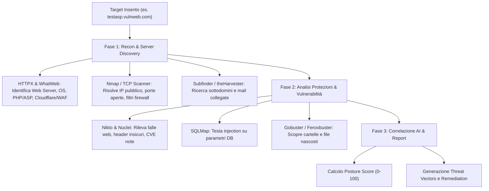
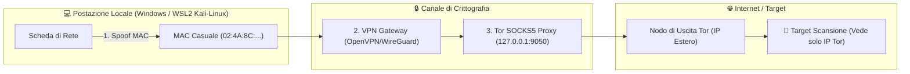

# 🛡️ TORNET — OPSEC & ANONYMITY SHIELD (PIANO OPERATIVO)

> **Documento:** Piano di Architettura e Implementazione "Anonymity Shield"  
> **Target:** `F:\Tornet\TORNET_OPSEC_PLAN.md`  
> **Autore:** TorNet Core Team  
> **Data:** 29 Ottobre 2026  
> **Stato:** ✅ Completato e Testato con Successo (100%)  
> **Licenza:** Open Source (MIT)

---

## 📋 INDICE

1. [Visione e Obiettivo](#-visione-e-obiettivo)
2. [Come Funziona Attualmente la Scansione (Recon & Vulnerability Pipeline)](#-come-funziona-attualmente-la-scansione)
3. [Architettura OPSEC — I Tre Scudi](#-architettura-opsec--i-tre-scudi)
   - [Scudo 1: MAC Changer (Mascheramento Identità Hardware)](#1-scudo-mac-changer-mascheramento-identità-hardware)
   - [Scudo 2: Tor Network (Instradamento Onion a Nodi Multipli)](#2-scudo-tor-network-instradamento-onion-a-nodi-multipli)
   - [Scudo 3: VPN Gateway (Tunnel Crittografato OpenVPN/WireGuard)](#3-scudo-vpn-gateway-tunnel-crittografato)
4. [Matrice di Combinazione e Livelli di Stealth](#-matrice-di-combinazione-e-livelli-di-stealth)
5. [Integrazione nella Dashboard (UI Header & Modale)](#-integrazione-nella-dashboard-ui-header--modale)
6. [Architettura Backend e API REST](#-architettura-backend-e-api-rest)
7. [Adattamento del Motore di Scansione (`ToolWrapper`)](#-adattamento-del-motore-di-scansione-toolwrapper)
8. [Piano di Sviluppo a Fasi (Checklist)](#-piano-di-sviluppo-a-fasi-checklist)
9. [Requisiti e Pacchetti Linux/Kali](#-requisiti-e-pacchetti-linuxkali)
10. [Protocollo di Test e Verifica](#-protocollo-di-test-e-verifica)

---

## 🎯 Visione e Obiettivo

Durante le attività di penetration testing e audit di sicurezza, l'operatore espone costantemente il proprio indirizzo IP pubblico, l'impronta TCP/IP e l'identità hardware verso i sistemi di rilevamento (IDS/IPS, WAF, Cloudflare, log dei firewall perimetrali).

L'obiettivo del modulo **OPSEC & Anonymity Shield** è dotare TORNET di una barra di controllo nella testata dell'applicazione con **3 pulsanti a commutazione rapida (toggle buttons)**:

```
[ 🛡️ MAC: SPOOFED ]   [ 🧅 TOR: ACTIVE ]   [ 🔒 VPN: CONNECTED ]   [ 🌐 IP: 185.220.101.5 (DE) Tor Exit ]
```

L'utente può:
- Attivare **uno qualsiasi** dei singoli moduli;
- Attivarne **due a piacere**;
- Attivarli **tutti e tre contemporaneamente** per ottenere la massima furtività operativa (*Tri-Shield Stealth Mode*).

---

## 🔍 Come Funziona Attualmente la Scansione

Per comprendere l'impatto dell'OPSEC, ecco come TORNET analizza un target quando premi **START**:



### Cosa Rileva Automaticamente:
1. **Server & Hosting:** Indirizzo IPv4/IPv6 reale, provider ISP (AWS, Hetzner, DigitalOcean), reverse DNS.
2. **Protezioni Perimetrali:** Rilevamento presenza WAF (Cloudflare, Akamai, Imperva, ModSecurity), rate limiting, porte filtrate da firewall.
3. **Tecnologie & Versioni:** Server web (Nginx, Apache, IIS), linguaggio backend (PHP, Python, ASP.NET), framework e CMS (WordPress, Drupal, Joomla).
4. **Falle e Bug:** Vulnerabilità CVE note, SQL injection, XSS, misconfiguration, directory sensibili esposte (`.git`, `phpinfo.php`, `backup.zip`).

> [!IMPORTANT]
> **Senza OPSEC attivo:** Tutti questi pacchetti di ricognizione partono direttamente dalla tua connessione di casa/ufficio. Il target vede il tuo IP reale nei propri log.  
> **Con OPSEC attivo:** Il traffico transita attraverso la VPN, la rete Tor o entrambi, e l'hardware locale viene mascherato.

---

## 🛡️ Architettura OPSEC — I Tre Scudi



---

### 1. Scudo MAC Changer (Mascheramento Identità Hardware)

#### Scopo
Modificare l'indirizzo Media Access Control (MAC) fisico o virtuale per impedire il tracciamento a livello Layer 2 (Data Link) su reti locali, router Wi-Fi o log DHCP.

#### Funzionamento Tecnico
- **Livello Linux (WSL2 Kali-Linux):**
  - Utilizzo dell'utility `macchanger` sull'interfaccia di rete virtuale:
    ```bash
    sudo ip link set eth0 down
    sudo macchanger -r eth0
    sudo ip link set eth0 up
    ```
- **Livello Windows Host (Opzionale / Avanzato):**
  - Query PowerShell via script per randomizzare il MAC della scheda di rete fisica attiva (Wi-Fi o Ethernet) modificando il valore di registro `NetworkAddress` e riavviando l'adattatore.
- **Funzionalità TORNET:**
  - **Randomize MAC:** Genera un indirizzo MAC vendors-valid o completamente casuale.
  - **Reset MAC:** Ripristina l'indirizzo MAC originale memorizzato al primo avvio.
  - **Status Badge:** Mostra l'indirizzo MAC attuale e lo stato (ORIGINALE / SPOOFED).

---

### 2. Scudo Tor Network (Instradamento Onion a Nodi Multipli)

#### Scopo
Rendere anonimo il traffico TCP e HTTP delle scansioni, facendolo rimbalzare attraverso 3 nodi crittografati mondiali (Guard Node → Relay Node → Exit Node).

#### Funzionamento Tecnico
- **Demone Tor:**
  - Esecuzione del servizio `tor` all'interno dell'ambiente Kali Linux (`Kali-Linux`):
    ```bash
    sudo service tor status || sudo service tor start
    ```
  - Esposizione locale del proxy SOCKS5 su `127.0.0.1:9050` e porta di controllo su `127.0.0.1:9051`.
- **Instradamento degli Strumenti:**
  - **Strumenti con proxy nativo (HTTPX, Nuclei, Nikto, SQLMap):**
    - Flag automatica: `--proxy socks5://127.0.0.1:9050` (o `http://127.0.0.1:8118` se abbinato a Privoxy).
  - **Strumenti CLI generici (Nmap, Gobuster, Curl):**
    - Wrapping automatico tramite `proxychains4`:
      ```bash
      proxychains4 -q -f /etc/proxychains4.conf nmap -sT -Pn -p 80,443 <target>
      ```
      *(Nota tecnica: Nmap su Tor richiede scansione TCP Connect `-sT -Pn` poiché Tor non supporta pacchetti RAW SYN/ICMP).*
- **Funzionalità TORNET:**
  - **Tor Toggle ON/OFF:** Avvia/arresta il servizio Tor nel sottosistema.
  - **New Identity (New Circuit):** Invio del segnale `SIGNAL NEWNYM` sulla porta di controllo 9051 per cambiare immediatamente nodo di uscita e IP pubblico.
  - **Circuit Inspector:** Mostra l'IP di uscita attuale e il paese geografico del nodo di uscita.

---

### 3. Scudo VPN Gateway (Tunnel Crittografato)

#### Scopo
Creare un tunnel cifrato end-to-end (AES-256 o ChaCha20) tra la postazione e un server VPN remoto prima che qualsiasi pacchetto raggiunga la rete internet.

#### Funzionamento Tecnico
- **Tecnologie Supportate:** OpenVPN (`.ovpn`) e WireGuard (`.conf`).
- **Gestione Profili:**
  - Directory dedicata in `f:\Tornet\backend\data\vpn\`.
  - L'utente può caricare file di configurazione del proprio provider preferito (es. Mullvad, ProtonVPN, NordVPN, o server VPS personale).
- **Controllo del Tunnel:**
  - Connessione e disconnessione gestite in background tramite `openvpn --config <file>.ovpn --daemon` o `wg-quick up/down`.
  - Monitoraggio dell'interfaccia di rete creata (`tun0` o `wg0`).
  - **Kill Switch & DNS Leak Prevention:** Verifica che non vi siano perdite DNS inviando query solo ai DNS della VPN.

---

## 🎛️ Matrice di Combinazione e Livelli di Stealth

L'utente può combinare liberamente i tre interruttori:

| MAC | TOR | VPN | Modalità Risultante | Livello di Anonimato | Velocità Scansione | Caso d'Uso Tipico |
|:---:|:---:|:---:|:---|:---:|:---:|:---|
| ❌ | ❌ | ❌ | **Standard (Direct)** | ⚪ Minimo (IP Reale esposto) | ⚡⚡⚡ Massima (100%) | Test in rete locale o server di proprietà |
| ✅ | ❌ | ❌ | **MAC Spoof Only** | 🟡 Locale protetto, IP esposto | ⚡⚡⚡ Massima (100%) | Test su Wi-Fi pubblico o LAN aziendale |
| ❌ | ✅ | ❌ | **Tor Direct** | 🟢 Alto (Multi-hop Onion) | 🐢 Moderata (30-50%) | Web audits, directory fuzzing anonimo |
| ❌ | ❌ | ✅ | **VPN Tunnel** | 🔵 Buono (Tunnel cifrato mono-hop) | ⚡⚡ Alta (85-95%) | Scansioni massive veloci ma protette |
| ✅ | ❌ | ✅ | **MAC + VPN** | 🟣 Molto Alto (Identità hardware + IP cifrato) | ⚡⚡ Alta (85-95%) | Standard Red Team professionale |
| ❌ | ✅ | ✅ | **Tor over VPN** | 🟠 Estremo (ISP vede solo VPN, Target vede solo Tor) | 🐢 Lenta (25-40%) | Evasione blocchi geografici e censura |
| ✅ | ✅ | ✅ | **TRI-SHIELD ULTIMATE** | 🔴 Inviolabile (MAC Random + VPN + Tor Exit) | 🐢 Lenta (25-40%) | Massima riservatezza investigativa |

---

## 🖥️ Integrazione nella Dashboard (UI Header & Modale)

### 1. Posizionamento nel Header (`frontend/src/components/Header.jsx`)

Nella barra superiore (accanto all'orologio e al cambio lingua) verranno inseriti:

```
┌────────────────────────────────────────────────────────────────────────────────────────────────────────────────┐
│ 🔴 TORNET COMMAND CENTER  [Live WS: Connected]     │ [🛡️ MAC] [🧅 TOR] [🔒 VPN] │ [🌐 IP: 185.x.x.x 🇩🇪] │ 🇮🇹 IT │
└────────────────────────────────────────────────────────────────────────────────────────────────────────────────┘
```

#### Stati Visivi dei Toggle Buttons:
1. **Pulsante MAC:**
   - **Disattivo:** Grigio scuro con icona scudo barrato (`MAC: Default`).
   - **Attivo:** Ciano neon lampeggiante con MAC spoofed (`MAC: 02:4A:8C:...`).
2. **Pulsante TOR:**
   - **Disattivo:** Grigio scuro con cipolla opaca (`Tor: Off`).
   - **In Connessione:** Giallo ambra pulsante (`Tor: Connecting...`).
   - **Attivo:** Viola/Magenta neon con IP nodo di uscita (`Tor: 185.220.101.5 🇩🇪`).
3. **Pulsante VPN:**
   - **Disattivo:** Grigio scuro con lucchetto aperto (`VPN: Disconnected`).
   - **Attivo:** Smeraldo verde neon con nome profilo (`VPN: Proton-NL 🇳🇱`).
4. **Badge IP Pubblico Dinamico:**
   - Interroga in real-time l'IP pubblico effettivo con cui escono le richieste.
   - Mostra bandierina del paese di origine e tag di protezione (`Direct` / `VPN` / `Tor Exit`).
   - Pulsante circolare "🔄 Refresh" per verificare istantaneamente se l'IP è cambiato.

---

### 2. Modale Dettagliata OPSEC ("OpsecControlModal")

Cliccando su uno qualsiasi dei tre pulsanti o sul badge IP, si apre una modale dark-mode con 3 schede:

#### Scheda 1: 🛡️ Hardware & MAC
- Elenco delle schede di rete disponibili (Host e WSL).
- Indirizzo MAC originale (Factory MAC) memorizzato in sicurezza.
- Indirizzo MAC attuale.
- Pulsanti: `[🎲 Genera MAC Casuale]` — `[↺ Ripristina Originale]` — `[📋 Copia]`.

#### Scheda 2: 🧅 Rete Tor
- Stato del demone Tor (Avviato / Fermo / PID).
- Tempo di uptime del circuito.
- Nodo di guardia (Guard), Nodo intermedio (Relay), Nodo di uscita (Exit).
- Pulsanti: `[⚡ Nuovo Circuito (New Identity)]` — `[Restart Tor]` — `[Test Connessione Onion]`.

#### Scheda 3: 🔒 VPN Gateway
- Selettore profili VPN (`.ovpn` o `.conf`).
- Area Drag & Drop per caricare nuovi file di configurazione VPN.
- Toggle per inserimento credenziali utente/password (se richieste dal profilo).
- Pulsante `[Connetti Tunnel]` / `[Disconnetti Tunnel]`.
- Grafico in tempo reale di traffico tunnel (Bytes In / Bytes Out).

---

## ⚙️ Architettura Backend e API REST

Nuovo modulo backend in `f:\Tornet\backend\app\opsec\`:

```
f:\Tornet\backend\app\opsec\
├── __init__.py
├── models.py           # Schemi Pydantic e stato di memoria (OpsecState)
├── service.py          # Logica operativa (wsl macchanger, tor control, openvpn daemon)
└── routes.py           # Endpoint REST per il frontend
```

### Endpoint REST (`/api/v1/opsec/`)

| Metodo | Endpoint | Descrizione |
|---|---|---|
| `GET` | `/api/v1/opsec/status` | Restituisce lo stato globale di tutti e 3 gli scudi e l'IP pubblico attuale |
| `POST` | `/api/v1/opsec/ip/check` | Forza una verifica immediata dell'IP pubblico, nazione e ISP |
| `POST` | `/api/v1/opsec/mac/spoof` | Randomizza l'indirizzo MAC dell'interfaccia specificata |
| `POST` | `/api/v1/opsec/mac/restore` | Ripristina l'indirizzo MAC originale |
| `POST` | `/api/v1/opsec/tor/start` | Avvia il servizio Tor in WSL e attende l'apertura della porta 9050 |
| `POST` | `/api/v1/opsec/tor/stop` | Arresta il servizio Tor |
| `POST` | `/api/v1/opsec/tor/new-identity` | Invia il comando NEWNYM alla porta 9051 per cambiare IP di uscita |
| `GET` | `/api/v1/opsec/vpn/profiles` | Elenca tutti i profili `.ovpn` / `.conf` presenti su disco |
| `POST` | `/api/v1/opsec/vpn/upload` | Carica un nuovo profilo VPN |
| `POST` | `/api/v1/opsec/vpn/connect` | Avvia il processo OpenVPN con il profilo selezionato |
| `POST` | `/api/v1/opsec/vpn/disconnect` | Termina il processo VPN attivo |

---

## 🔄 Adattamento del Motore di Scansione (`ToolWrapper`)

Attualmente `ToolWrapper.run()` esegue i comandi direttamente in bash dentro WSL:
```python
final_cmd = ["wsl", "-d", self.wsl_distro, "--", "bash", "-c", cmd_str]
```

Con l'integrazione OPSEC, il metodo `build_command` e `run` controlleranno lo stato attivo di **Tor**:

1. Se **Tor è DISATTIVO**:
   - Il comando viene eseguito normalmente (o transiterà attraverso la VPN se la VPN è attiva a livello di sistema operativo).
2. Se **Tor è ATTIVO**:
   - **Per tool con supporto nativo proxy (Nuclei, HTTPX, SQLMap, Nikto):**
     - Vengono iniettati automaticamente gli argomenti di proxy:
       - Nuclei: `-proxy socks5://127.0.0.1:9050`
       - HTTPX: `-http-proxy socks5://127.0.0.1:9050`
       - SQLMap: `--proxy=socks5://127.0.0.1:9050`
       - Nikto: `-useproxy http://127.0.0.1:8118` (o wrapper proxychains)
   - **Per tutti gli altri tool (Nmap, Gobuster, WhatWeb, Feroxbuster, ecc.):**
     - Il comando viene prefissato con `proxychains4 -q`:
       ```bash
       proxychains4 -q <tool_command>
       ```
     - Per Nmap viene forzata la modalità TCP Connect: `-sT -Pn` (necessaria per passare attraverso tunnel SOCKS).

Tutti i log del terminale WebSocket mostreranno un badge identificativo:
`[OPSEC: TOR ROUTED]` o `[OPSEC: VPN PROTECTED]` per informare l'operatore che la richiesta è instradata in sicurezza.

---

## 📋 Piano di Sviluppo a Fasi (Checklist)

### Fase 1: Preparazione Ambiente Linux & Pacchetti OPSEC
- [x] Verificare e installare in Kali WSL (`Kali-Linux`): `tor`, `macchanger`, `openvpn`, `proxychains4`, `curl`
- [x] Configurare `/etc/tor/torrc` con porta SocksPort 9050 e ControlPort 9051 abilitata
- [x] Configurare `/etc/proxychains4.conf` con `socks5 127.0.0.1 9050`
- [x] Creare directory backend per i profili VPN: `f:\Tornet\backend\data\vpn\`

### Fase 2: Backend OPSEC Service & Controller
- [x] Creare `f:\Tornet\backend\app\opsec\models.py` con modelli di stato
- [x] Creare `f:\Tornet\backend\app\opsec\service.py` con metodi:
  - `get_public_ip()`: query HTTPS asincrona per determinare IP, paese, ASN
  - `spoof_mac()` / `restore_mac()`: gestione `macchanger` su eth0 / Wi-Fi
  - `start_tor()` / `stop_tor()` / `new_tor_identity()`
  - `connect_vpn()` / `disconnect_vpn()`
- [x] Creare `f:\Tornet\backend\app\opsec\routes.py` con gli endpoint REST
- [x] Registrare il router in `f:\Tornet\backend\app\main.py`
- [x] Testare gli endpoint via script Python

### Fase 3: Modifica del Motore di Scansione (`ToolWrapper`)
- [x] Aggiornare `f:\Tornet\backend\app\tools\base.py` per leggere lo stato OPSEC globale
- [x] Aggiungere supporto a `proxychains4` e proxy SOCKS5 automatico
- [x] Adattare i comandi Nmap a TCP Connect `-sT -Pn` quando Tor è attivo
- [x] Aggiungere messaggi informativi OPSEC nel feed del terminale WebSocket

### Fase 4: Frontend Header & Componenti UI
- [x] Creare `f:\Tornet\frontend\src\components\OpsecHeaderControls.jsx` (I 3 pulsanti pill + Badge IP)
- [x] Creare `f:\Tornet\frontend\src\components\OpsecModal.jsx` (Dettagli, grafici, profili VPN, cambio circuito)
- [x] Integrare `OpsecHeaderControls` in `f:\Tornet\frontend\src\components\Header.jsx`
- [x] Aggiungere funzioni API dedicate in `f:\Tornet\frontend\src\api\client.js`
- [x] Aggiungere chiavi di traduzione (Italiano + Inglese) in `f:\Tornet\frontend\src\i18n\translations.js`

### Fase 5: Collaudo, Test di Leak e Verifica
- [x] Test cambio MAC: verifica con `ip link show`
- [x] Test attivazione Tor: verifica cambio IP pubblico da IP italiano ad IP estero Tor
- [x] Test New Identity: verifica che l'IP cambi su comando
- [x] Test scansione Nmap / HTTPX tramite Tor (verifica nei log terminale)
- [x] Test caricamento profilo VPN ed eventuale tunnel
- [x] Test Tri-Shield simultaneo (MAC + VPN + Tor)
- [x] Verifica build frontend `npm run build` senza errori

---

## 📦 Requisiti e Pacchetti Linux/Kali

I seguenti pacchetti sono necessari in `Kali-Linux` (Kali Linux WSL2):
```bash
# 1. Aggiornamento e installazione tool di anonimato
sudo apt-get update
sudo apt-get install -y tor macchanger openvpn proxychains4 resolvconf

# 2. Configurazione Tor ControlPort (per new identity)
# In /etc/tor/torrc:
# ControlPort 9051
# CookieAuthentication 0
```

---

## 🧪 Protocollo di Test e Verifica

Prima di considerare completata la feature, verranno eseguiti i seguenti controlli rigorosi:

1. **IP Leak Test:**
   - Esecuzione `curl https://api.ipify.org` prima e dopo l'attivazione di Tor/VPN.
   - L'IP risultante DEVE essere differente dal tuo IP di connessione reale.
2. **Tor Exit Node Check:**
   - Interrogazione endpoint ufficiale `https://check.torproject.org/api/ip`.
   - DEVE restituire `"IsTor": true`.
3. **DNS Leak Test:**
   - Verifica che le richieste DNS non trapelino verso i server DNS del provider telefonico di casa.
4. **Resilienza Strumenti:**
   - Esecuzione di una scansione di prova su `testasp.vulnweb.com` con Tor attivo per accertare che i tool non vadano in timeout e che i risultati vengano estratti e visualizzati correttamente nella dashboard.

---

> [!TIP]
> **Prossimo Passo:** Una volta revisionato e approvato questo documento, confermami di procedere e avvierò l'implementazione partendo dalla Fase 1 (configurazione pacchetti in Kali Kali-Linux e backend service).


